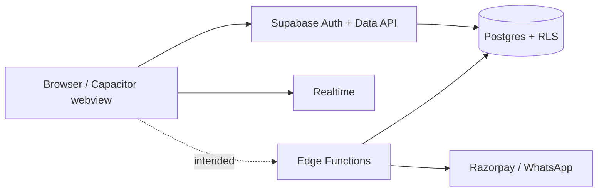

# Architecture audit

## Evidence basis

Source review on 2026-10-10, read-only Supabase dashboard inspection, production web bundle build, and unauthenticated browser smoke test.

## Data path

Current source sends cart, wishlist, addresses, profile changes and legacy order reads directly through the browser client. Product data is seeded in HTML/JS and can hydrate from `product_catalog`. No deployed Edge Function exists. The app lacks a server-authoritative checkout, wallet ledger, durable delivery-occurrence model, and local Supabase schema baseline.

## Verified live Supabase facts

| Area | Finding | Effect |
| --- | --- | --- |
| Auth | 12 accounts observed | OTP flow needs dedicated synthetic-account test |
| Database | 13 public tables, RLS enabled | Policy correctness remains critical |
| Functions | No Edge Functions deployed | Razorpay/WhatsApp cannot work live |
| Backups | Free plan; no scheduled backups/PITR | Migration rollback risk |
| Migrations | No recorded dashboard migrations | Schema cannot be reproduced safely |
| DNS | Dashboard reports healthy; local resolver failed | DNS must be rechecked outside sandbox |

## Security architecture gaps

1. Critical: unsafe delivery partner setup grants creation/activation and broad pool visibility. Prepared lockdown migration removes this from current project, but it has not been applied.
2. Critical: checkout and MilkCash lacked a trusted server write path. Browser-side creation/spending is now blocked.
3. High: `SECURITY DEFINER` views/functions exist live and public execution grants are too broad. `SECURITY DEFINER` must use a pinned search path, explicit ownership check, and narrow execute grants.
4. High: old WhatsApp function accepted browser-controlled order/customer/total. It now accepts only `orderId` and loads the RLS-scoped record.
5. High: current source has no reproducible initial migration/config/test database.
6. Medium: legacy local order and subscription drafts can still be displayed. They must never be promoted to live state.
7. Medium: legacy login/profile code has overlapping handlers and obsolete direct `Users` table calls. It needs consolidation after the backend baseline is captured.

## Required target boundary

- Client submits product IDs, quantities, delivery request, wallet amount, payment method and idempotency key.
- One authenticated PostgreSQL RPC validates DB prices/stock/address, creates immutable order records and wallet entries in one transaction.
- Razorpay webhook verifies payment and changes payment/order state. Browser never confirms payment.
- Admin-only server paths assign delivery partners and make adjustments.
- Customer/direct Data API remains for low-risk personal cart, wishlist, address and profile data only, protected by per-user RLS.
