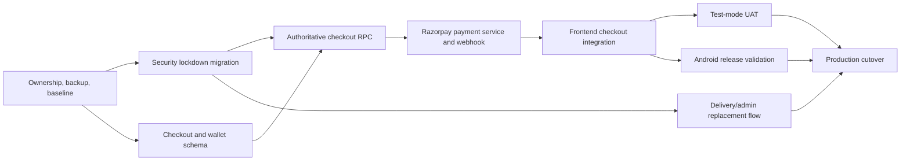

# JFAM production-release plan

## Outcome

Release a secure JFAM web and Android app where the server, not the browser, creates orders, calculates money, records wallet changes, and confirms Razorpay payments. The current checkout remains safely blocked until the authoritative flow is tested.

Payment is the largest visible blocker, but it is not the only production blocker. Release also depends on database access control, reproducible migrations, backups, delivery data privacy, and tested recovery from interrupted payments.

## Guardrails

- Keep Supabase, Razorpay, plain JavaScript, and Capacitor.
- Do not accept a total, “payment succeeded” claim, wallet balance, or order status from the browser.
- Use Razorpay test mode before live keys.
- Keep Razorpay key secrets and webhook secrets in Supabase secrets; never place them in source code, Android builds, or chat.
- Apply database changes as reviewed, versioned migrations. Take an export before each live migration.
- Make additive changes first. Do not remove existing fields or data until the replacement flow is live and reconciled.
- No live payments, refunds, or destructive data changes during development/UAT.

## Current state

- The client-side order and MilkCash paths are disabled. A checkout cannot create an order from the browser.
- Manual UPI confirmation is blocked. A Razorpay status response in the client does not confirm an order.
- The live Supabase project has RLS enabled, but several delivery-partner policies and public helper functions need removal or replacement.
- There is no deployed payment-verification endpoint or authoritative checkout RPC.
- The project has no recorded Supabase migration history, linked repository, or verified backup process.
- The Android wrapper syncs, but a local Android debug build needs an installed Android SDK configured in `android/local.properties`.

## Release tracks and dependencies

### Track 0 — ownership, recovery, and release baseline

**0.1 Confirm operational ownership** — Record the Supabase organization owner, Razorpay account owner, Google Play Console owner, Android signing-key custodian, domain/DNS owner, and source repository administrator. Remove departed developers only after a verified replacement owner exists.

- Acceptance: each service has two active company-controlled administrators and recovery contact details.
- Verification: review access lists in the service dashboards; record only role/owner status, never credentials.

**0.2 Establish backup and rollback evidence** — Export the production database schema and data according to the chosen Supabase plan, export Razorpay configuration references, and capture current app version and policies.

- Acceptance: a dated recovery package exists outside the application repository and restoration steps have an owner.
- Verification: test restoring the schema/data to a non-production project or document why that cannot yet occur.

**0.3 Link source control and create environments** — Push the clean repository to a company-owned private GitHub repository. Create a separate Supabase staging project and Razorpay test-mode configuration.

- Acceptance: development/test and production use different URLs, keys, and data.
- Verification: staging build cannot point at production credentials; repository protection requires review for migrations.

### Track 1 — database migration foundation and immediate security containment

**1.1 Capture the remote schema as versioned source** — Generate a baseline of the live Supabase schema, policies, functions, extensions, and publication settings. Store reviewed SQL migrations under `supabase/migrations/`.

- Acceptance: a new environment can be recreated from ordered migrations without dashboard-only steps.
- Verification: apply migrations to the staging project and compare tables, policies, functions, and grants with the approved baseline.

**1.2 Apply the delivery-partner lockdown migration** — Apply the existing reviewed migration that removes public partner self-enrolment, shared unassigned-order visibility, and direct delivery mutation paths. Do this only after export and review because active delivery workflows will change.

- Acceptance: a normal authenticated customer cannot create/activate a delivery partner, browse the unassigned pool, or read another customer’s order/profile/items.
- Verification: SQL/RLS tests with customer and partner test accounts; dashboard policy and function-grant review.

**1.3 Replace unsafe delivery administration** — Add an admin-only partner assignment path and a server-controlled delivery-status update function. Do not recreate broad reads to make the old screen work.

- Acceptance: only authorized staff can assign a partner; a partner sees only assignments explicitly assigned to them.
- Verification: RLS matrix tests for customer, assigned partner, unassigned partner, and admin.

**1.4 Remove remaining insecure public interfaces** — Review security-definer views/functions, mutable function search paths, public `EXECUTE` grants, realtime publication, legacy login lookup, and table write policies. Replace each public interface with least-privilege grants or an authenticated server endpoint.

- Acceptance: Security Advisor findings are either resolved or have an approved documented exception with a compensating control.
- Verification: run Advisor and SQL permission tests in staging and production after each migration.

### Track 2 — authoritative order, schedule, and wallet data model

**2.1 Add immutable checkout records** — Introduce additive tables/columns for checkout attempts, immutable product-price snapshots, delivery occurrences, idempotency records, and payment-event deduplication. Preserve existing order data for read-only history until reconciliation.

- Acceptance: an order item and each delivery occurrence retain its quantity, unit price, status, and adjustment history even if the product later changes.
- Verification: migration tests for required constraints, foreign keys, and rollback on injected failure.

**2.2 Create an append-only MilkCash ledger** — Replace browser localStorage as the source of truth with server-only wallet transactions, available balance calculation, unique financial references, and linked reversals.

- Acceptance: no client can credit/debit a wallet directly; balances cannot become negative; a duplicate debit cannot occur.
- Verification: concurrent debit, duplicate idempotency key, replay, reversal, and localStorage-tampering tests.

**2.3 Define order and subscription state rules** — Write the allowed transitions for one-time orders, subscriptions, pause/resume/skip, cancellation, failed payment, expiry, refund, and delivery completion. Put these checks in server functions, not page state.

- Acceptance: every order state has one owner, allowed next states, and an audit event.
- Verification: unit/SQL transition table tests cover allowed and rejected transitions.

### Track 3 — isolated Razorpay payment service

**3.1 Configure Razorpay safely** — Confirm the company controls the Razorpay account. Use test keys in staging and set `RAZORPAY_KEY_ID`, `RAZORPAY_KEY_SECRET`, and `RAZORPAY_WEBHOOK_SECRET` as Supabase Edge Function secrets. The key ID may be exposed to the browser only if required; the secret and webhook secret never may be.

- Acceptance: secrets are absent from Git, `www`, Android assets, browser storage, logs, and chat.
- Verification: repository secret scan; Edge Function configuration review; test key shown only in staging configuration.

**3.2 Create the payment-attempt service** — Build an authenticated server endpoint that receives only an approved checkout attempt identifier, creates the corresponding Razorpay order/payment link/QR as appropriate, and stores provider identifiers and a pending state. It must use the already calculated server amount.

- Acceptance: a client cannot choose amount, currency, recipient, captured status, or another customer’s payment attempt.
- Verification: API tests for authorization, amount tampering, duplicate requests, and idempotent attempt creation.

**3.3 Create a raw-body Razorpay webhook verifier** — Deploy a dedicated Edge Function that validates Razorpay’s webhook HMAC using the raw request body, deduplicates the Razorpay event ID, fetches/validates payment facts where needed, and calls a restricted database function to transition the associated payment/order.

- Acceptance: only a verified Razorpay webhook or authorized finance-admin action can move a payment to confirmed/paid.
- Verification: valid signature, invalid signature, altered body, replayed event, delayed event, and out-of-order event tests.

**3.4 Implement pending/failed/expired/refund handling** — Keep UPI and online payments in `PENDING_PAYMENT_VERIFICATION` until a verified event arrives. Define expiry and finance-admin review paths. Refunds create linked ledger reversal records and never edit past ledger rows.

- Acceptance: refresh, Android process death, and duplicate taps cannot produce a duplicate order/charge or an incorrect success screen.
- Verification: browser and Android-resume UAT for pending, failure, expiry, replay, and approved refund.

### Track 4 — authoritative checkout RPC

**4.1 Build `create_checkout` as one transaction** — Implement a restricted Supabase RPC with product identifiers/quantities, plan/dates, slot, saved-address identifier, payment method, requested MilkCash usage, and idempotency key. It resolves catalog prices and availability, validates ownership, locks/debits wallet if permitted, creates order/snapshots/items/occurrences/payment attempt, and returns the authoritative result.

- Acceptance: a forced failure at every step leaves no partial records; an identical idempotency key returns the original response without a second debit/order.
- Verification: SQL transaction failure injection, concurrent checkout, idempotency, price-tampering, address-ownership, and insufficient-wallet tests.

**4.2 Separate payment method behavior** — COD, wallet-only, Razorpay online, and manual/offline UPI must each have explicit server states. Manual UPI cannot self-confirm. COD creation must follow an approved business rule and delivery-area/limit checks.

- Acceptance: method-specific state changes are server enforced and visible in the returned authoritative order.
- Verification: matrix tests for every method and all rejected state transitions.

**4.3 Authorize admin exceptions** — Create a narrowly scoped finance/admin action for verified manual payment or remediation, logging who acted, why, previous state, new state, and reference.

- Acceptance: a regular user cannot invoke the exception path; every override is auditable.
- Verification: RLS/grant tests and audit-record review.

### Track 5 — frontend and Android integration

**5.1 Make checkout state truthful** — Replace the current temporary blocked messaging with server-backed checkout states: review, payment pending, payment failed, payment confirmed, order confirmed, and retry. Never present an order confirmation until the server returns it.

- Acceptance: users can clearly recover after refresh, delayed webhook, back navigation, duplicate tap, or payment cancellation.
- Verification: Playwright flows and manual Android UAT.

**5.2 Wire the frontend to the authoritative API** — Generate a checkout idempotency key per intent, disable duplicate submissions, invoke `create_checkout`, then open the approved Razorpay method only from the server response. Cache status for display only; reload from Supabase to resume.

- Acceptance: modifying localStorage, request totals, or browser payment flags cannot change payable amount/order state/wallet balance.
- Verification: browser DevTools tampering test, offline/retry test, and duplicate-click test.

**5.3 Keep location and address privacy aligned** — Retain the existing consented location picker. Persist a chosen address only through an authenticated server path with validated delivery bounds and clear customer consent. Do not make precise coordinates public to delivery partners.

- Acceptance: address ownership and delivery-area validation are server enforced.
- Verification: address cross-account access test and inside/outside-service-area tests.

**5.4 Android release readiness** — Configure the Android SDK only on development/CI machines, build a signed internal-test APK/AAB from a clean checkout, and test UPI handoff, backgrounding, process death, restart, back navigation, permissions, and pending-payment recovery.

- Acceptance: the Android internal track installs and resumes the same authoritative order/payment state as web.
- Verification: emulator/device test checklist plus CI debug build.

### Track 6 — quality, operations, and launch

**6.1 Automated test suite and CI** — Add focused JavaScript unit tests, SQL security/integrity tests, Playwright checkout flows, and Android build checks. Require these for pull requests and migrations.

- Acceptance: tests cover success, pending, failure, rejection, offline retry, duplicate taps, webhook replay, concurrency, and RLS isolation.
- Verification: clean checkout CI run with archived reports.

**6.2 Monitoring and operational runbooks** — Add privacy-safe logs and alerts for checkout RPC failure, webhook verification failure, payment/order state mismatch, failed migration, and Edge Function errors. Write recovery runbooks for stuck payments, webhook replay, failed migration, and refund.

- Acceptance: staff can identify a payment attempt by safe reference and resolve it without database edits from the dashboard.
- Verification: tabletop drill using Razorpay test events.

**6.3 Staged release** — Run internal web/Android UAT with Razorpay test mode, reconcile orders against payment attempts, enable production webhook/key configuration only after sign-off, then monitor a limited launch period.

- Acceptance: production launch checklist is signed by product, finance, engineering, and operations owners.
- Verification: first-live-payment reconciliation and post-launch review.

## Milestones

| Milestone | Includes | Exit condition |
|---|---|---|
| M0: Recover control | Track 0 | Company owns all services and can restore data |
| M1: Stop exposure | Track 1 | Customer/partner privacy and privilege tests pass |
| M2: Server owns money | Track 2 + Track 4 | Orders/wallets are transactional and idempotent |
| M3: Verified payment | Track 3 | Razorpay test payment lifecycle is webhook-verified |
| M4: Usable clients | Track 5 | Web and Android resume verified server states |
| M5: Release candidate | Track 6 | Tests, monitoring, runbooks, and staged UAT pass |

## Migration explanation

A migration is a small, ordered SQL file that changes the shared Supabase database: for example, adding an idempotency table, removing a dangerous policy, or creating the checkout RPC. It runs once per environment and becomes part of the project’s source history.

It is necessary because this app’s production behavior is defined by database tables, RLS policies, permissions, and functions. Changing those only through the Supabase dashboard leaves no dependable history, cannot be reviewed properly, and cannot be reproduced in staging or restored after a mistake. Versioned migrations make the precise change, its review, its test, and its rollback/recovery plan visible.

The first security migration already prepared locally is intentionally small: it removes public delivery-partner escalation and broad delivery visibility. It does not delete customer/order data. It can temporarily stop parts of the old delivery screen because that screen relies on unsafe access; the replacement admin assignment flow is planned immediately after it. Before applying it live, take an export, review the affected policies, and approve that exact live permission change.

## Explicit release gates

Do not enable live Razorpay payments until all of these are true:

1. Company-owned Supabase and Razorpay admin access is confirmed.
2. A current production backup/export is verified.
3. The security lockdown and checkout migrations are applied and tested in staging.
4. `create_checkout`, wallet ledger, and Razorpay webhook pass idempotency and replay tests.
5. Browser and Android test-mode UAT passes.
6. Finance can reconcile every test payment to one payment attempt and one order.
7. Monitoring and a stuck-payment/refund runbook exist.
8. The Android signing and Play Console ownership are company controlled.
